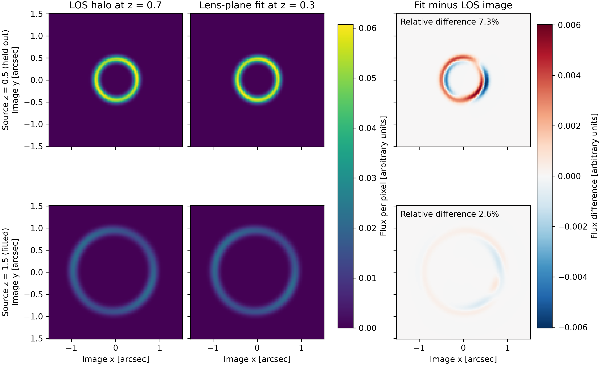
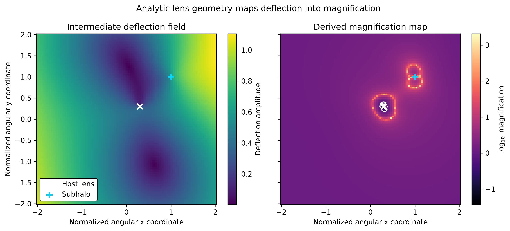
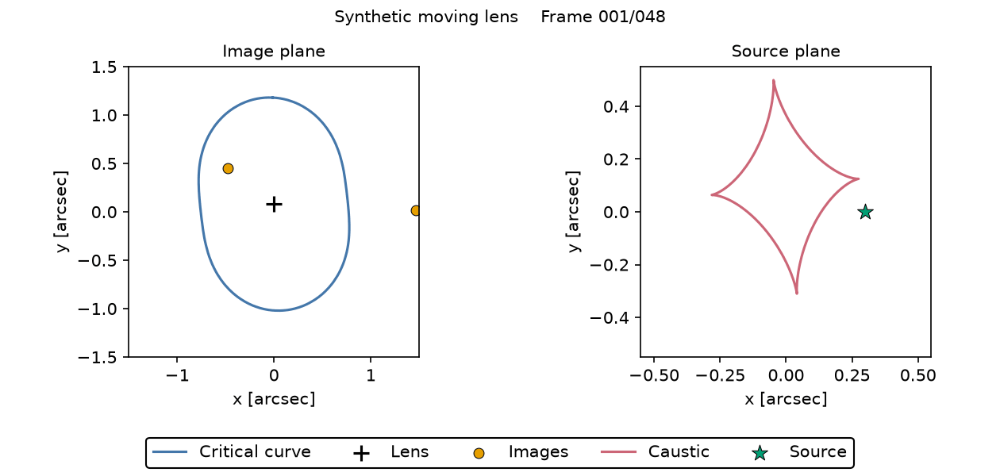
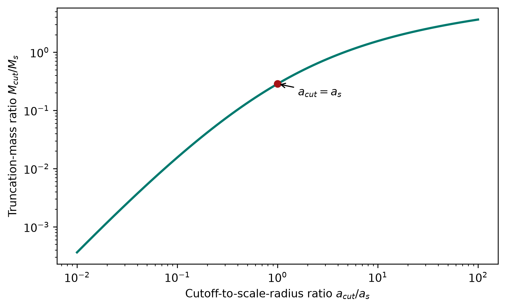

# Chalcedon

The name comes from [ancient Chalcedon](https://en.wikipedia.org/wiki/Chalcedon), in present-day Kadikoy, Istanbul. Here, Chalcedon names the lens-physics layer that turns a mass distribution into deflections and lensed images.

## Overview
Follow light through a specified lens configuration with Chalcedon. Provide a
host lens, source, subhalos, and external shear to calculate deflections,
magnifications, critical curves, and caustics. Inspect the lens equation behind
the resulting arcs.

## Scope
The calculations range from analytic deflection profiles to strong-lens image rendering. I keep them here so the modeling and inference packages can use the same lens physics.

Chalcedon provides the gravitational-lensing engines used by PCAT, Ephesos, and Pergamon:
- Singular isothermal ellipsoid (`retr_deflsie`) and Plummer-softened point-mass (`retr_deflplum`) deflections, truncated- and untruncated-NFW subhalo deflections (`retr_deflsubh`), external shear (`retr_deflextr`), and a combined host+subhalo+shear evaluator (`retr_defl`).
- Convergence, inverse magnification, and power-spectrum estimators from a deflection field (`retr_convfromdefl`, `retr_invmfromdefl`, `retr_psecconv`), plus critical curves and caustics (`retr_magn`, `retr_caustics`).
- Truncated-halo mass kernels (`retr_mcutfrommscl`, `retr_mcut`).
- Einstein-radius and self-lensing utilities (`retr_radieins_inft`, `retr_radieinsfromsmax`, `retr_radieinssbin`, `retr_amplslen`, `retr_magnpntslens`, `evaluate_self_lensing_model`) used by ephesos and PCAT.
- Cosmological lensing distances and critical density (`retr_adislenssour`, `retr_mdencrit`, `retr_ratimassbeinsqrd`).

## Native strong-lens models

`chalcedon.strong_lensing` provides composable `LensModel`, `LensEquationSolver`, `LensCosmo`, and `LensModelExtensions` interfaces. They calculate deflections, source-plane coordinates, numerical Jacobians, convergence, magnification, image positions, critical curves, and caustics. Supported mass profiles include SIS, SIE, EPL, point mass, shear, convergence, NFW, truncated NFW, core-truncated NFW, cored NFW, pseudo double-power-law, ULDM soliton, circular Gaussian, and elliptical NFW/Hernquist. Coordinates, Einstein radii, and angular scale radii use arcseconds. Multiple lens planes use distance-weighted ray propagation with Astropy cosmology.

`chalcedon.imaging` supplies flux-normalized Sersic, Gaussian, Hernquist, interpolated-image, and Cartesian-shapelet light models, angular coordinate grids, point sources, and PSF convolution. The `ImageModel` evaluates the lens equation on supersampled coordinates, convolves the fine scene, and sums subpixel count rates into detector pixels. Mejiro defaults to these calculations with `backend="chalcedon"` without loading Lenstronomy and retains a separate Lenstronomy backend for comparisons.

Elliptical halo profiles are integrated directly from their projected density using inherited CSE parameter conventions. Sersic half-light constants use the inverse incomplete gamma function. Finite-difference Jacobians and grid-seeded image solving need sufficiently fine steps and grids for the desired accuracy. Unsupported profiles, extinction and special rendering options, and JAX execution raise explicit errors. The included lensing engine uses NumPy and SciPy.

## Multiple source planes

Render extended light components at different source redshifts in one image by
passing `source_redshift_list` to `ImageModel`, with one redshift per
source-light profile. The lens must use `multi_plane=True`, an Astropy cosmology,
and a reference `z_source` behind every lens plane. Its mass-profile parameters
specify reduced deflections at that reference redshift. Changing a component's
source redshift changes the distance ratios while keeping the physical lens
distribution fixed. Lenses at or behind that source contribute zero deflection.
Profiles at the same redshift can represent separate parts of one galaxy.

`LensModel.ray_shooting(..., z_source=...)` exposes the same calculation for
individual rays. Deflections, Hessians, convergence, magnification, and
`LensEquationSolver.image_position_from_source()` accept the same explicit
`z_source` selection. Omitting it retains the original reference-source
behavior. The point-source parameter blocks passed to `ImageModel.image()`
still use the reference source plane.

```bash
python examples/multiple_source_planes.py --typefileplot png
python examples/multiple_source_planes.py --typefileplot pdf --typeplotback dark
```

This explicitly synthetic example places a source at redshift 0.5 between an
SIS host at redshift 0.3 and a truncated NFW halo at redshift 0.7. A second
source at redshift 1.5 lies behind both lenses. Both source images and their
sum share one brightness scale and a Gaussian PSF. Timestamped figures and
matching compressed numerical arrays go directly into the example's `visuals/`
directory. With the Bokeh extra installed, each run also writes a self-contained
interactive view. Existing outputs are preserved.

## Halo redshift ambiguity

```bash
python examples/multiple_source_planes.py --compare-halos --typefileplot png
```

This synthetic comparison fits a lens-plane truncated NFW halo at redshift 0.3
to an image generated with a line-of-sight halo at redshift 0.7. I keep the
macro lens, source light, and PSF fixed while fitting the halo's angular scale,
normalization, and position using only the source at redshift 1.5. The same
fitted halo then predicts the nearer source at redshift 0.5, which lies in
front of the original line-of-sight halo.



The far-source relative image difference falls from 20% to 2.6%. For the
nearer source, the fitted model differs by 7.3%. Each percentage is the
Euclidean norm of the image residual divided by the norm of the corresponding
synthetic reference image. Similar far-source images therefore leave a
larger mismatch at the second source distance in this example.

The fit reaches the upper bounds on scale radius and horizontal position.
The allowed angular scale spans one third of a pixel to the field half-width,
the halo center stays within the image field, and the nonnegative reduced
normalization is bounded by the host's 1 arcsec Einstein angle. The truncation
radius remains fixed at 0.5 arcsec. These illustrative bounds constrain the
reported minimum. The calculation has neither image noise nor a posterior
over lens and source properties, so the residuals alone cannot establish
observational distinguishability.

Timestamped NPZ files retain the original, initial, and fitted images,
residuals, source and lens parameters, fit bounds and active-bound flags,
PSF and pixel settings, and the generating script's hash. Existing files are
preserved. Pass `--typefileplot pdf` for a vector figure.

## Installation

```bash
cd /path/to/chalcedon
python -m pip install -e .
export CHALCEDON_PATH=/path/to/chalcedon
```

`CHALCEDON_PATH` identifies the repository root. Keep runtime inputs in `data/` and generated pipeline outputs in `visuals/`. Both directories are ignored by Git.

## Minimal usage

The runnable analytic example evaluates a host lens, one subhalo, and external shear on a normalized angular grid:

```bash
python examples/microlens_caustic.py --typefileplot png
```

The analytic example uses white backgrounds with black axes. Add
`--typeplotback dark` for black backgrounds with white axes, or pass
`typeplotback='dark'` to its `run_example()` function from Python.



The left panel shows the deflection amplitude returned by `chalcedon.retr_caustics()`. The right panel shows the resulting magnification map and contour candidates. Host and subhalo positions are marked explicitly. Both panels show deterministic predictions from the example's stated parameters. No observed image data enter the calculation.

## Moving lens and source

The animation uses Chalcedon's native SIS-plus-shear model, image solver, and
critical-curve calculation. The blue curve is critical in the image plane.
Its mapping is the pink source-plane caustic. Yellow points show the images,
the green star is the source, and the cross marks the moving lens. Crossing
the caustic changes the number of images between two and four.

```bash
python examples/microlens_caustic.py --animate --frames 48
python examples/microlens_caustic.py --animate --frames 48 --typeplotback dark
```



The Einstein angle is 0.9 arcsec and the external shear components are 0.18
and 0.04. The two objects follow prescribed angular tracks rather than a
dynamical orbit. Each frame solves the lens equation anew. Both viewports stay
fixed, and the legend remains outside the data panels. New GIFs and their
numeric JSON sidecars receive timestamps and preserve earlier outputs.
The sidecar records positions, phases, lens-equation residuals, model settings,
and the source-code hash. `--animation-output` selects an explicit new path.

## Truncated-halo mass

The enclosed-mass example evaluates the analytic kernel over positive cutoff-to-scale-radius ratios:

```bash
python examples/plot_truncation_mass.py --typefileplot png
python examples/plot_truncation_mass.py --typefileplot png --bokeh
```

The [`truncation_mass.ipynb` notebook](examples/truncation_mass.ipynb) calls the
same plotting function and shows the dimensionless mass ratios at selected
cutoff radii.

Add `--typeplotback dark` for black backgrounds with white axes in both the
static and HTML figures. The Python entry points also accept
`typeplotback='dark'` and inherit a surrounding TDpy theme when it is omitted.



Install `python -m pip install -e '.[bokeh]'` to create the interactive companion at `examples/visuals/truncation_mass.html`.

`retr_mcutfrommscl(radius_ratio)` accepts scalars or NumPy arrays and returns the dimensionless mass ratio. At equal cutoff and scale radii, the ratio is $\pi/4 - 1/2$. The mass increases monotonically with cutoff radius for the assumed truncated profile. Use `retr_mcut` to calculate the corresponding halo mass from the profile normalization, angular radii, lens distance, and critical surface density. The returned masses follow the assumed analytic profile, with no halo-mass measurements used.

## Inspecting the result
Look at the deflections and magnification alongside the rendered image. A convincing-looking arc is more useful when I can trace it back to the supplied mass and light profiles and check the numerical resolution.
