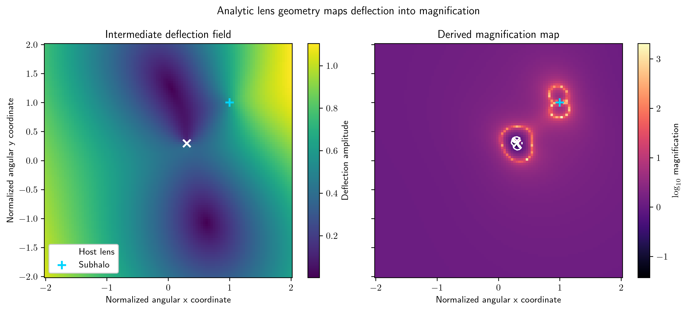
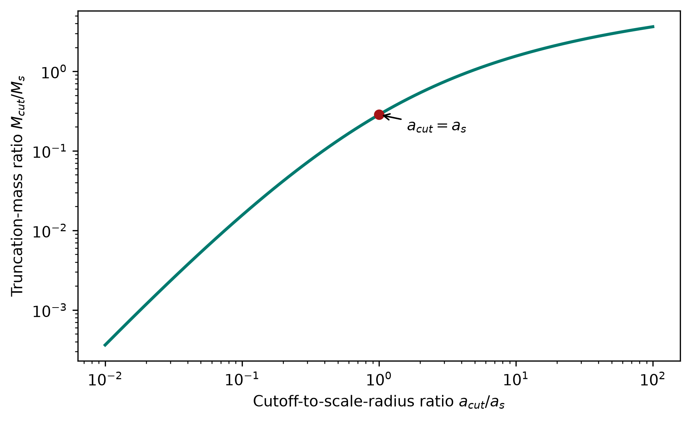

# Chalcedon

## Purpose
Chalcedon puts the shared gravitational-lensing calculations in one place. Give it a lens, source, subhalo, and shear configuration, and it computes the deflections, magnifications, critical curves, and caustics that follow.

## Scope
Use Chalcedon to calculate lens deflections and magnifications, identify critical-curve contours, and see how host lenses, subhalos, and external shear shape an image-plane signal.

Chalcedon is the single upstream home for the gravitational-lensing engines shared across this ecosystem's maintained repositories (PCAT, Ephesos, and Pergamon). It owns:
- Singular isothermal ellipsoid (`retr_deflsie`) and Plummer-softened point-mass (`retr_deflplum`) deflections, truncated- and untruncated-NFW subhalo deflections (`retr_deflsubh`), external shear (`retr_deflextr`), and a combined host+subhalo+shear evaluator (`retr_defl`).
- Convergence, inverse magnification, and power-spectrum estimators from a deflection field (`retr_convfromdefl`, `retr_invmfromdefl`, `retr_psecconv`), plus critical curves and caustics (`retr_magn`, `retr_caustics`).
- Truncated-halo mass kernels (`retr_mcutfrommscl`, `retr_mcut`).
- Einstein-radius and self-lensing utilities (`retr_radieins_inft`, `retr_radieinsfromsmax`, `retr_radieinssbin`, `retr_amplslen`, `retr_magnpntslens`, `evaluate_self_lensing_model`) used by ephesos and PCAT.
- Cosmological lensing distances and critical density (`retr_adislenssour`, `retr_mdencrit`, `retr_ratimassbeinsqrd`).

## Installation

```bash
cd /path/to/chalcedon
python -m pip install -e .
export CHALCEDON_PATH=/path/to/chalcedon
```

`CHALCEDON_PATH` identifies the repository root. Keep runtime inputs in `data/` and generated pipeline outputs in `visuals/`; both directories are ignored by Git.

## Minimal usage

The runnable analytic example evaluates a host lens, one subhalo, and external shear on a normalized angular grid:

```bash
python examples/microlens_caustic.py --typefileplot png
```



The left panel exposes the intermediate deflection amplitude returned by `chalcedon.retr_caustics()`. The right panel shows the resulting magnification map and its contour candidates. Host and subhalo positions are marked explicitly. This is a deterministic lens-model prediction under the parameters encoded in the example, not an observed image.

## Truncated-halo mass

The enclosed-mass example evaluates the analytic kernel over positive cutoff-to-scale-radius ratios:

```bash
python examples/plot_truncation_mass.py --typefileplot png
python examples/plot_truncation_mass.py --typefileplot png --bokeh
```



Install `python -m pip install -e '.[bokeh]'` to create the interactive companion at `examples/truncation_mass.html`.

`retr_mcutfrommscl(radius_ratio)` accepts scalars or NumPy arrays and returns the dimensionless mass ratio. At equal cutoff and scale radii, the ratio is $\pi/4 - 1/2$. The mass increases monotonically with cutoff radius for the assumed truncated profile. Use `retr_mcut` to calculate the corresponding halo mass from the profile normalization, angular radii, lens distance, and critical surface density. These are analytic model predictions, not measured halo masses. The example, documentation, and mathematical tests were transferred from Aspendos.

## Output and diagnostics
A useful run should produce the input lensing configuration, relevant intermediate geometric quantities, and the final simulated or diagnostic image output in a reproducible and inspectable form.
